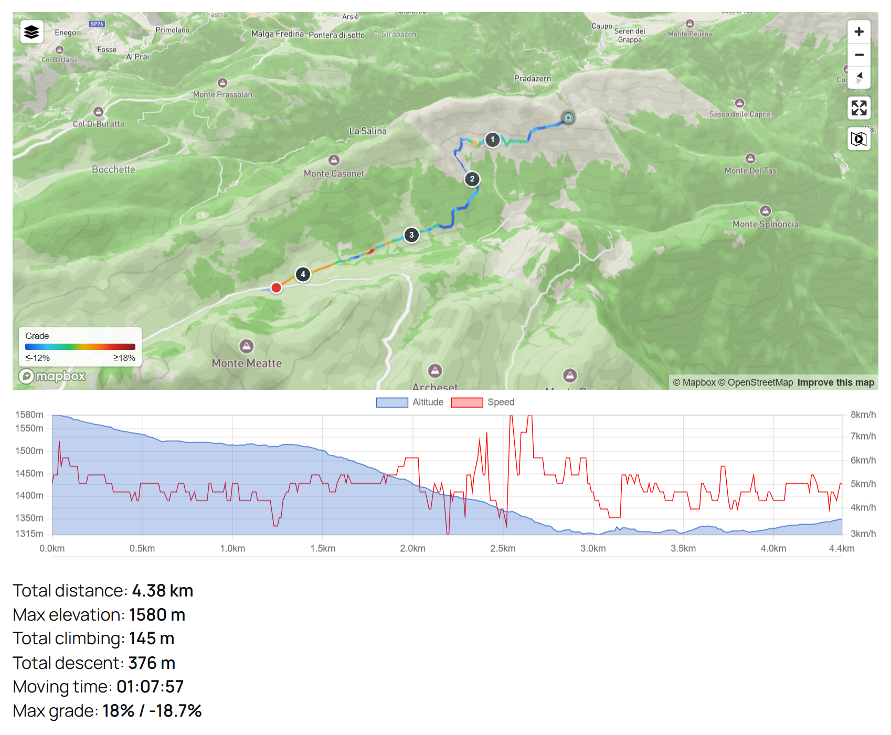

# WP GPX Maps

[](https://github.com/devfarm-it/wp-gpx-maps/actions/workflows/ci.yml)
[](https://wordpress.org/plugins/wp-gpx-maps/)
[](https://wordpress.org/plugins/wp-gpx-maps/)
[](https://www.gnu.org/licenses/gpl-2.0.html)

WordPress plugin that shows GPX, FIT, TCX and KML tracks on an interactive map (Leaflet or Mapbox, with 3D terrain)
with elevation, speed and heart rate charts and a route summary. It has a block for the block editor and the `[sgpx]`
shortcode.

**Users:** install it from [wordpress.org/plugins/wp-gpx-maps](https://wordpress.org/plugins/wp-gpx-maps/). The
description, FAQ and changelog are in [readme.txt](readme.txt), the file published on wordpress.org.
This page is for developers.



## Repository

The root of the repository is the plugin folder. wordpress.org SVN is updated only by GitHub Actions when a version tag is pushed.

| Path | What |
| --- | --- |
| `wp-gpx-maps.php` | Plugin bootstrap, `[sgpx]` shortcode, assets, track description and structured data |
| `wp-gpx-maps-formats.php` | Track files: GPX, TCX, KML / KMZ and FIT readers and the common point builder |
| `wp-gpx-maps-utils.php` | Points, statistics, colors, merge of several files, waypoints |
| `wp-gpx-maps-block.php`, `blocks/map/` | "GPX Map" block (plain JS on the `wp.*` globals, no build) and the `wp-gpx-maps/v1/tracks` REST route |
| `wp-gpx-maps-admin*.php`, `wp-gpx-maps-help.php` | Settings, Tracks and Help tabs |
| `assets/src/` | TypeScript: map engines (`maps-engines/`), chart, utilities |
| `assets/dist/` | Built ES module and CSS (committed, loaded by the plugin) |
| `dev/` | Local test site in Docker and test track files |
| `.wordpress-org/` | Banner, icons and screenshots of the wordpress.org page |
| `.distignore` | Files that are not published to wordpress.org |

## Development

Requirements: Node.js 22, Docker, and PHP with Composer for the coding standards (or run them in the Docker container).

```bash
npm install
npm run build        # assets/src -> assets/dist
```

### Local test site

`dev/` runs WordPress 7.1 with PHP 8.4 and mounts this repository as the plugin.

```bash
cd dev
docker compose up -d
pwsh ./setup.ps1     # first time only
```

`setup.ps1` installs WordPress, activates the plugin, copies the files of `dev/gpx` to `wp-content/uploads/gpx` and
creates one post for every test case (several tracks, no time or elevation, corrupted file, FIT / TCX / KML,
map types...). The site runs on http://localhost:8080 and the admin credentials are written to `dev/.env`, which is not committed.

### Checks

```bash
composer install
vendor/bin/phpcs     # phpcs.xml.dist: PHPCompatibilityWP (PHP 7.4+) and WordPress.Security
```

On every push and pull request [CI](.github/workflows/ci.yml) runs:
- PHP lint from 7.4 to 8.4;
- PHPCS;
- the JS build;
- [Plugin Check](https://wordpress.org/plugins/plugin-check/) on the files that would be published.

## API for add-ons

Add-ons can extend the maps without changing the plugin. The API version is `WPGPXMAPS_API_VERSION` (currently `1`);
it changes only when a hook changes in a way that is not backward compatible.

### PHP filters and actions

| Hook | Arguments | Use |
| --- | --- | --- |
| `wpgpxmaps_shortcode_atts` | `$attr` | Change the attributes of a map before it is drawn |
| `wpgpxmaps_block_shortcode_atts` | `$atts, $attributes` | Attributes produced by the block |
| `wpgpxmaps_map_extra` | `$extra, $attr` | Data for your script, received as `params.extra` in the `wpgpxmaps:ready` event |
| `wpgpxmaps_map_html` | `$output, $attr, $id` | HTML of a map (map, chart, summary, download link) |
| `wpgpxmaps_track_description` | `$text, $info, $attr` | Text description of the track (screen readers, search engines, AI) |
| `wpgpxmaps_structured_data` | `$data, $info, $attr` | schema.org `TouristTrip` JSON-LD of the map; return an empty value to remove it |
| `wpgpxmaps_load_assets` | `$found` | Load the map style in the head of the page (default: only when a post has a map) |
| `wpgpxmaps_lazy_load` | `$lazy, $attr` | Start the map only when it gets near the screen (default `true`) |
| `wpgpxmaps_enqueue_scripts` | | Action: enqueue your scripts and styles where maps are shown |
| `wpgpxmaps_admin_tabs` / `wpgpxmaps_admin_tab_{tab}` | `$tabs` | Add a tab to Settings > WP GPX Maps and print its content |

### PHP functions

- `wpgpxmaps_get_track_info( $gpx )`: summary of a track, cached until the file changes. Returns start, end,
  bounds, length, climbing / descent, max / min elevation, duration and a line of up to 100 points.
- `wpgpxmaps_module_url()`: URL of the JavaScript module, which exports `WPGPXMaps` and `Leaflet`.
- `wpgpxmaps_enqueue_assets()`: map style with the Leaflet CSS, for add-ons that draw their own maps.

### JavaScript event

```js
document.addEventListener( 'wpgpxmaps:ready', ( event ) => {
	const { apiVersion, engine, map, chart, container, params } = event.detail;
	// engine: 'leaflet' or 'mapbox'; map: the Leaflet or Mapbox GL map; chart: the Chart.js chart
	// params.extra: the data added with the wpgpxmaps_map_extra filter
} );
```

### Example

```php
// Add a line under every map with the length of the track
add_filter( 'wpgpxmaps_map_html', function ( $html, $attr ) {
	$info = isset( $attr['gpx'] ) ? wpgpxmaps_get_track_info( $attr['gpx'] ) : null;
	if ( $info ) {
		$html .= '<p>' . esc_html( round( $info['length'] / 1000, 1 ) . ' km' ) . '</p>';
	}
	return $html;
}, 10, 2 );
```

## Release

1. Update `Version:` and `WPGPXMAPS_CURRENT_VERSION` in `wp-gpx-maps.php`, `Stable tag:` and the changelog in `readme.txt`.
2. Merge into `master` with a green CI.
3. Push a tag with the version (for example `1.10.00`).

The [release workflow](.github/workflows/release.yml) checks that the tag and the three versions match, builds the
JS and publishes the plugin to wordpress.org. To update only the readme and the images of the wordpress.org page,
run the [readme-assets](.github/workflows/readme-assets.yml) workflow by hand.

## Contributing

- Bugs and ideas: [Discussions](https://github.com/devfarm-it/wp-gpx-maps/discussions) and issues.
- Pull requests are welcome. Run the checks above and add a test file to `dev/gpx` when you change how tracks are read.
- Support the development: [GitHub Sponsors](https://github.com/sponsors/bastianonm).

## License

GPLv2 or later. Copyright Bastianon Massimo and the [contributors](readme.txt).
